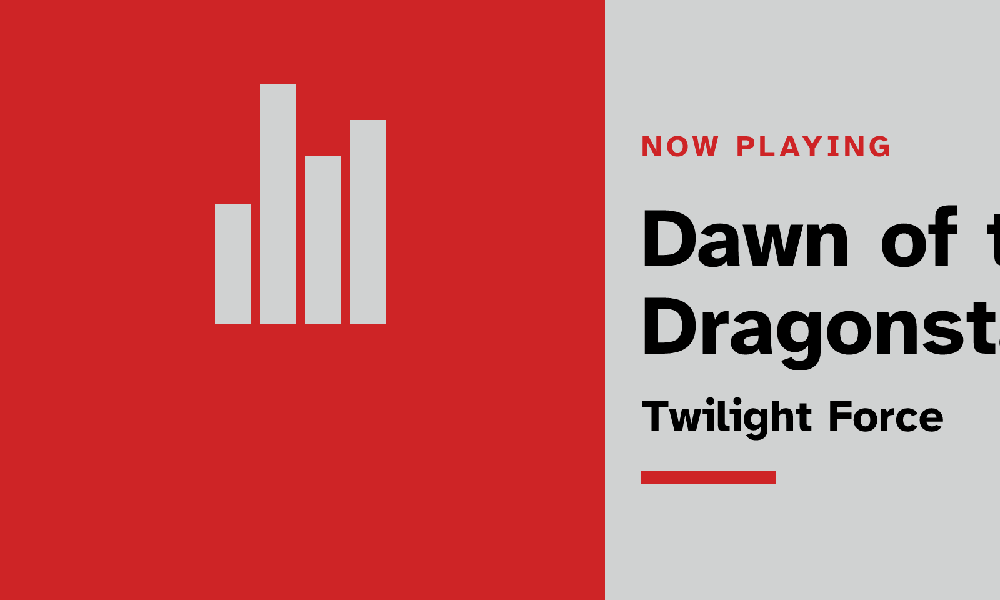
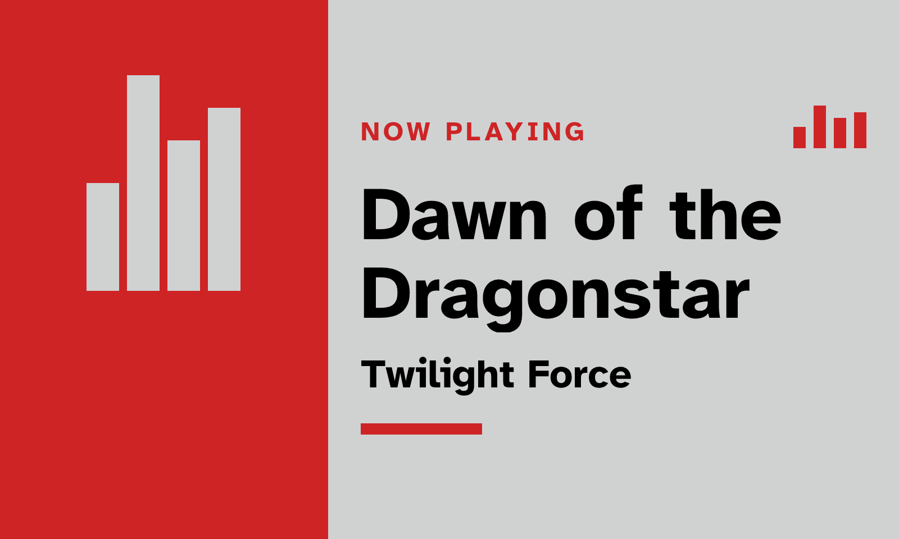
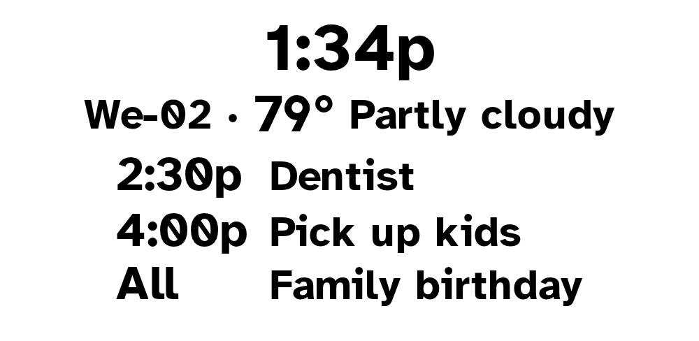
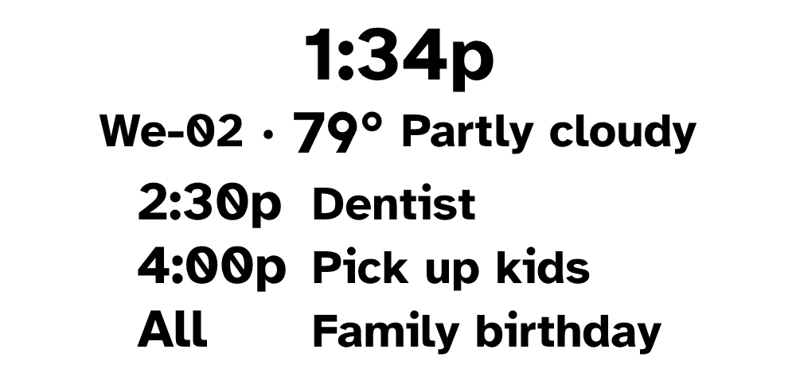
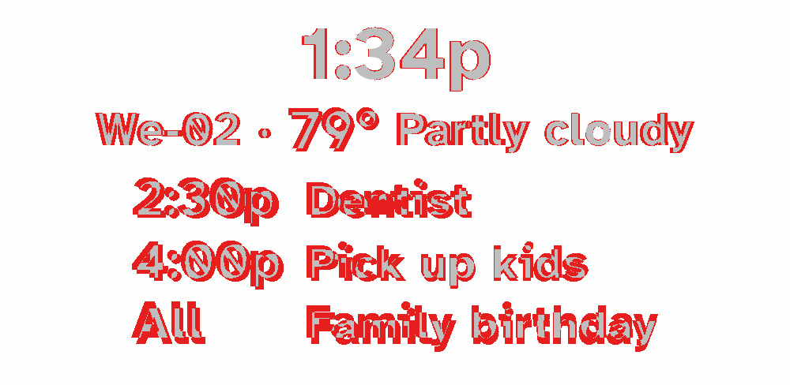

# Satori against Chromium, every server view (2026-10-13)

Production renders device images with Chromium (`INKCAST_RENDER_ENGINE=chromium`). This
bake-off asks what Satori would change if it rendered the same views, before and after
upgrading `satori` from 0.26.0 to 0.56.1.

## Method

- `pnpm bakeoff:views <engine> [name]` renders every view in `VIEW_NAMES` through
  `buildStoryView` (the Storybook fixtures, with the two `assets/sample-photos`) on the four
  image panel sizes the server drives: 250x122 monochrome, 800x480 and 1600x1200 Spectra 6,
  and 960x540 grayscale. Each case renders four times; the reported time is the warm median.
- `pnpm bakeoff:views:compare` counts a pixel as changed when any channel differs from
  Chromium by more than 48, writes a diff PNG per case, and builds
  `render-output/satori-bakeoff/index.html`.
- Run on the agent sandbox under `build-budget` (two logical CPUs). Absolute times are for
  comparison only.

## Summary

| Engine | Total time | Rendered | Median diff vs Chromium | Max diff | Median speedup |
| --- | ---: | --- | ---: | ---: | ---: |
| Chromium | 82,212 ms | 40 of 40 | — | — | — |
| Satori 0.26.0 | 29,827 ms | 36 of 40 | 1.95% | 37% | 2.6x |
| Satori 0.56.1 | 36,152 ms | 40 of 40 | 1.25% | 9.3% | 2.5x |

- **Satori 0.26.0 crashes the whole process** (a resvg panic, not a thrown error) on
  Photo Frame (Agenda), so the run skipped that view on every panel.
- **0.26.0 overflows Now Playing (Poster)** — the title runs off the panel, 22–37% of pixels
  differ. 0.56.1 wraps it like Chromium (2–5%).
- **Photo views are pixel-identical** in both versions and are where Satori saves the most:
  about 2.6 s against 1.0 s per 1600x1200 photo.
- What remains in 0.56.1 is text metrics: glyphs sit 1–3 px lower and the 250x122 glyphs are
  slightly heavier. Layouts match. The worst case (9.3%) is Clock (Agenda) on 250x122, where
  that shift covers a large share of a tiny panel.
- Peak process RSS (Chromium 808 MiB, Satori 746–764 MiB) is not a fair comparison: the
  Satori process also holds `tsx` and every loaded module. Satori does not start a browser.

## What it does not change

- **`vrt` and CI.** The visual check captures Storybook in Chromium; Satori is not in that
  path. This pull request changed no story.
- **Platform screens and Presto streams.** `renderPage` captures a live URL and the remote
  displays stream a live page; both need a browser. Satori only replaces `renderDevice`, the
  legacy image views.

## Pictures

Now Playing (Poster), 800x480 — Chromium, Satori 0.26.0, Satori 0.56.1:

Clock (Agenda), 250x122 (the worst 0.56.1 case) — Chromium, Satori 0.56.1, and the diff:

## Every case

| Panel | View | Chromium ms | Satori 0.26.0 ms | 0.26.0 diff | Satori 0.56.1 ms | 0.56.1 diff |
| --- | --- | ---: | ---: | ---: | ---: | ---: |
| phat-250x122-mono | Now Playing (Dashboard) | 120 | 32 | 8.2% | 28 | 8.2% |
| phat-250x122-mono | Now Playing (Poster) | 117 | 32 | 21.9% | 30 | 5% |
| phat-250x122-mono | Photo Frame | 251 | 103 | 0% | 98 | 0% |
| phat-250x122-mono | Photo Frame (Fill) | 248 | 101 | 0% | 106 | 0% |
| phat-250x122-mono | Photo Frame (Duo) | 257 | 104 | 0% | 101 | 0% |
| phat-250x122-mono | Photo Frame (Agenda) | 203 | crash | — | 83 | 3.7% |
| phat-250x122-mono | Clock | 105 | 21 | 0.4% | 20 | 0.4% |
| phat-250x122-mono | Clock (Weather) | 115 | 23 | 3.9% | 24 | 3.8% |
| phat-250x122-mono | Clock (Agenda) | 122 | 29 | 8.1% | 34 | 9.3% |
| phat-250x122-mono | Agenda | 117 | 32 | 3.9% | 35 | 4% |
| impression-800x480-spectra6 | Now Playing (Dashboard) | 168 | 60 | 4.3% | 67 | 3.1% |
| impression-800x480-spectra6 | Now Playing (Poster) | 160 | 70 | 34.2% | 65 | 2% |
| impression-800x480-spectra6 | Photo Frame | 614 | 233 | 0% | 230 | 0% |
| impression-800x480-spectra6 | Photo Frame (Fill) | 645 | 228 | 0% | 232 | 0% |
| impression-800x480-spectra6 | Photo Frame (Duo) | 657 | 239 | 0% | 244 | 0% |
| impression-800x480-spectra6 | Photo Frame (Agenda) | 412 | crash | — | 176 | 3.2% |
| impression-800x480-spectra6 | Clock | 165 | 49 | 1.4% | 42 | 1.1% |
| impression-800x480-spectra6 | Clock (Weather) | 163 | 43 | 1.7% | 45 | 1.3% |
| impression-800x480-spectra6 | Clock (Agenda) | 173 | 55 | 4.9% | 53 | 4.2% |
| impression-800x480-spectra6 | Agenda | 172 | 59 | 5.5% | 56 | 5.4% |
| impression-1600x1200-spectra6 | Now Playing (Dashboard) | 397 | 200 | 4.6% | 211 | 1.3% |
| impression-1600x1200-spectra6 | Now Playing (Poster) | 344 | 293 | 37% | 265 | 0.7% |
| impression-1600x1200-spectra6 | Photo Frame | 2656 | 1074 | 0% | 1147 | 0% |
| impression-1600x1200-spectra6 | Photo Frame (Fill) | 2688 | 1091 | 0% | 1127 | 0% |
| impression-1600x1200-spectra6 | Photo Frame (Duo) | 2676 | 1079 | 0% | 1131 | 0% |
| impression-1600x1200-spectra6 | Photo Frame (Agenda) | 1146 | crash | — | 774 | 1.2% |
| impression-1600x1200-spectra6 | Clock | 361 | 158 | 11.1% | 170 | 0.3% |
| impression-1600x1200-spectra6 | Clock (Weather) | 400 | 156 | 1.3% | 178 | 0.6% |
| impression-1600x1200-spectra6 | Clock (Agenda) | 420 | 198 | 2.2% | 228 | 1.5% |
| impression-1600x1200-spectra6 | Agenda | 406 | 211 | 2.9% | 218 | 1.5% |
| m5paper-960x540-gray | Now Playing (Dashboard) | 184 | 73 | 2.8% | 72 | 2.9% |
| m5paper-960x540-gray | Now Playing (Poster) | 164 | 77 | 29.2% | 82 | 1.3% |
| m5paper-960x540-gray | Photo Frame | 803 | 297 | 0% | 332 | 0% |
| m5paper-960x540-gray | Photo Frame (Fill) | 802 | 316 | 0% | 355 | 0% |
| m5paper-960x540-gray | Photo Frame (Duo) | 786 | 326 | 0% | 335 | 0% |
| m5paper-960x540-gray | Photo Frame (Agenda) | 438 | crash | — | 240 | 2.4% |
| m5paper-960x540-gray | Clock | 184 | 52 | 0.9% | 59 | 0.4% |
| m5paper-960x540-gray | Clock (Weather) | 175 | 51 | 1.5% | 62 | 0.9% |
| m5paper-960x540-gray | Clock (Agenda) | 194 | 69 | 3% | 75 | 2.6% |
| m5paper-960x540-gray | Agenda | 195 | 78 | 3.8% | 78 | 2.4% |
