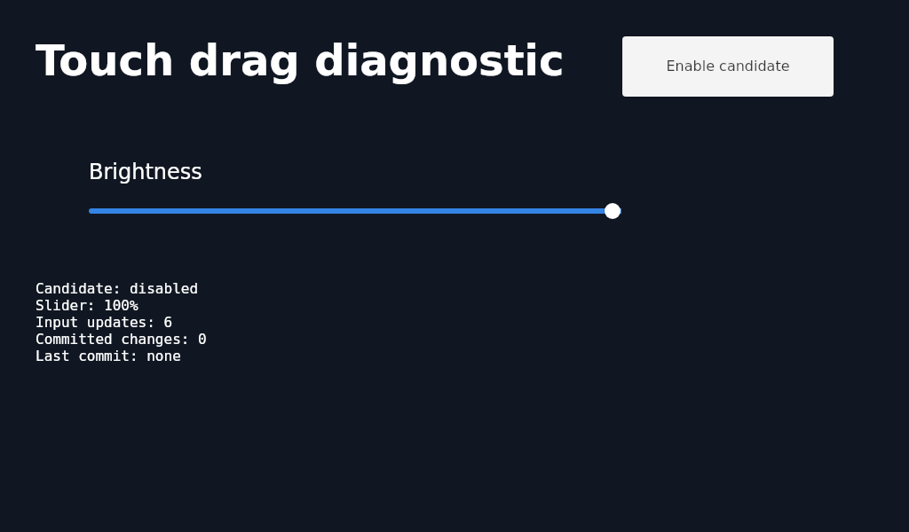
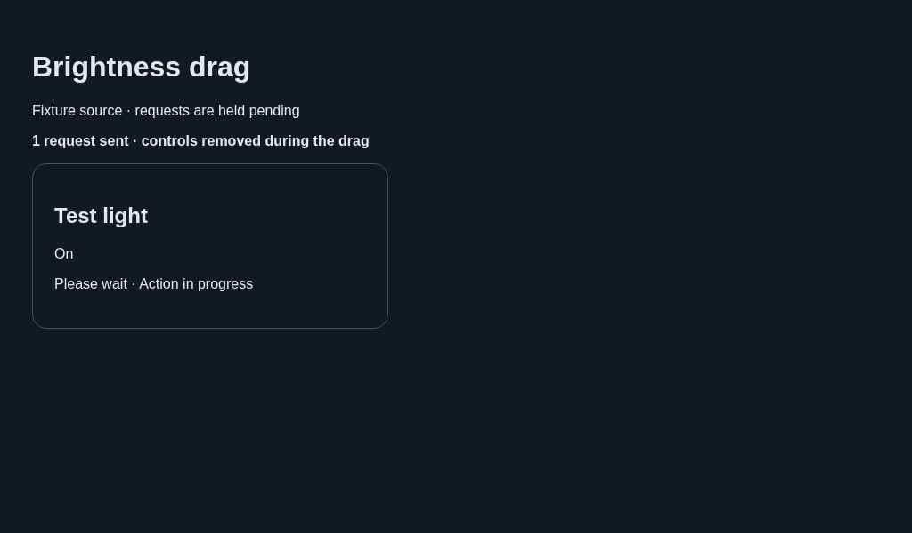
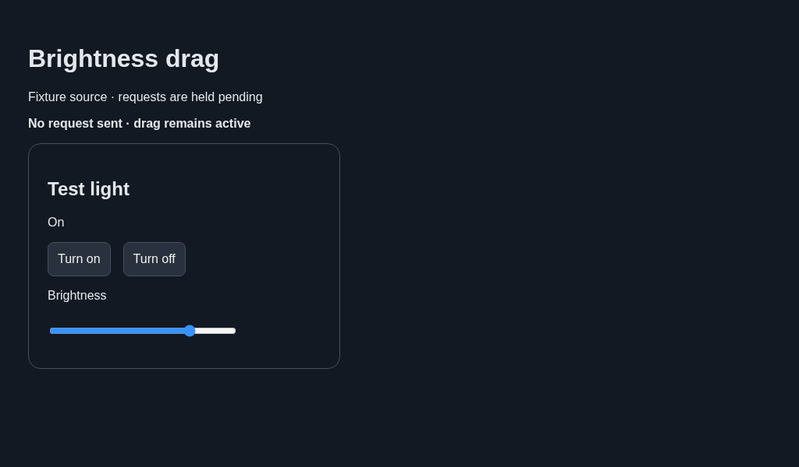

# Linux WPE native range touch handling

The Linux WebKit touch-pointer adapter now includes native range inputs. It keeps
the touch's original target, updates the native value and `input` events during
movement, and emits `change` once on release if the value changed. The native
setter supplies min/max/step sanitization; horizontal RTL reverses the fraction.
A cancelled contact does not emit a commit. Disabled/detached controls are ignored.
Mouse/keyboard and other native form controls keep their normal behavior. The
custom music-volume input retains its existing pointer handling.

A generated Linux direct-touch drag on WPE2.48.3/Cog0.18.4 moved an unmodified
native range from50 to100 but emitted no `change` on release. The identical drag
with the candidate emitted continuous input updates and a final change at100,
including movement below the original slider. This fixture does not operate a
real light. It verifies the event path, not subjective physical touch acceptance.

## Keep platform actions out of the active drag

The native event adapter alone did not qualify the full platform page. Its first
input update started a source request; pending-action rendering then removed or
disabled the range. A focus-triggered subscription refresh could also interrupt
the same interaction.

Platform range fields now keep a local draft and handle the native `change`
event on release. That event uses capture so a compatibility layer cannot
rewrite it into `input`. Visibility/access updates still refresh subscriptions;
focusing an embedded control leaves the current subscription intact. Existing
authorization, unavailable-source and pending-action gates still apply when a
command is sent. Keyboard changes still commit through the native event.

The regression includes an actual pending-action parent, source updates during
movement and focus, plus a real-server command and keyboard test in all four
windows. A page-local equivalent on actual WPE controlled a USB test backlight
at22% and restored100%. Physical feel remains an owner acceptance check.

These diagnostic fixtures keep source requests pending while the pointer is
still held, making the previous control removal visible:

